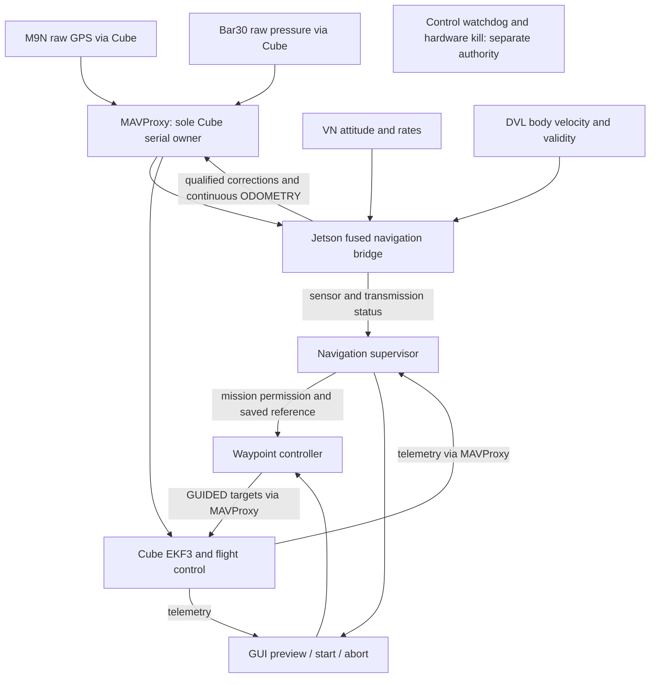

# Navigation architecture second review — October 12, 2026

## Scope and evidence

User requested another architecture and bug review after the previous model's
implementation. Reviewed current tether_toggle_beichen code at baseline 2d53d96:
core launch, process ownership, fused bridge/estimator, GPS quality/admission and
clock mapping, supervisor adapter/continuous policy, heading check, mission
reference, waypoint decision/transport/API, GUI launch ownership, shared MAVLink
transport, and the relevant kill/watchdog decisions. This is a focused navigation
review, not an exhaustive sonar, perception, firmware or electrical audit.
No vehicle access, deployment, parameter changes or main changes.
Existing untracked docs/nav_lgoic.md preserved without modification.

## Current responsibility boundaries

One bridge is selected by core launch. Both bridge implementations share the
same process-lifetime ownership lock. GUI generic navigation launch is blocked;
mission requests are serialized and duplicate Start is idempotent. Locks only
coordinate cooperating processes sharing the scope and filesystem, not separate
uncoordinated containers. Continuous supervisor does not select EKF sources.
Cube pose is not fed back as an independent bridge position measurement.

## Demonstrated bugs fixed

1. GPS admission status previously expired by receipt time only. A fix already
   250 ms old could remain qualified another 350 ms. Status now recomputes the
   Cube-fix age bound, revokes qualification when it expires or clock mapping is
   lost, and requires qualification again. Reported age now advances between fixes.
2. Pilot mode changes during final DISARM or ARM confirmation were not handled
   consistently with movement stages. The controller could issue its final
   disarm after a pilot selected MANUAL/STABILIZE. Those stages now abort on a
   fresh non-GUIDED mode and leave pilot control alone.
3. Preview and active waypoint checks compared the entire geographic origin,
   including altitude metadata. This conflicted with the bridge/supervisor's
   horizontal-origin rule and independent pressure/local-down reference.
   Altitude-only metadata updates now preserve the waypoint; horizontal origin
   changes, session changes, and local discontinuities still reject or abort.
4. NaN/infinite raw pressure was correctly rejected as depth but then retained in
   diagnostic JSON, causing allow_nan=False serialization to crash the bridge.
   Diagnostics now encode that pressure as null. Invalid depth still blocks
   odometry; this does not weaken sensor validity.

## Validation

- 165 Python tests passed under ROS Humble, including new regression cases for
  delayed fixes, lost timing mapping, pilot takeover, origin altitude changes,
  and invalid pressure serialization.
- Both waypoint and supervisor JavaScript rendering tests passed on Windows Node.
- Native continuous ROS/SITL GUI API mission passed all stages through COMPLETE,
  with GPS absent underwater, Cube pose available, duplicate Start idempotent,
  surface recovery and disarm. Recorded endpoint error ~0.145 m is a synthetic
  fixture result, not demonstrated physical accuracy.
- Separate continuous GUI/API Abort test passed and verified MANUAL after abort.
- Evidence: evidence/architecture-review-2026-10-12/{nominal,abort}.json.
  Native builds succeeded in the integrated runs; no QGC forwarding.
- Initial validation invocations encountered WSL sandbox denial, a missing Python
  import path, unavailable Node inside WSL, and wrong working directory for the
  Windows Node tests. Corrected execution environment and reran successfully;
  these were invocation failures, not passing tests or vehicle failures.

## Remaining architecture concerns

**Mission-process death is not a verified takeover mechanism.** Normal software
abort requests MANUAL, but a dead process cannot execute that path. In the current
kill_switch.py, autonomous() recognizes Cube flight mode and mission_claimed()
only expires a Bool claim; expiration alone does not force MANUAL while GUIDED
persists. A healthy selected link can therefore coexist with a lost mission owner.
No independent mission-death failsafe is established by this review, and actual
firmware target timeout behavior was not tested here. Before unattended missions,
design and fault-inject a separate run-scoped liveness guard, including false
timeouts, process death, pilot takeover, and Cube link loss. This requires a
deliberate control-authority decision rather than silently changing RF/kill policy.

Legacy source switching remains available and defaults are observation-only.
This is migration complexity, not two simultaneous bridges. A future cleanup
should retire legacy launch/profile/UI vocabulary together after commissioning,
not delete recovery paths piecemeal. Persistent Cube external-only parameters
must be reconciled with launch defaults and temporary service overrides at boot.

Estimator covariance/gains remain provisional; GPS timestamp is Cube last-fix
time, not exact receiver measurement time. DVL/VN loss deliberately stops output
and requires revalidation. GPS course cannot determine stationary yaw or remove
constant geographic bias. Physical heading, DVL scaling, pressure datum and
position accuracy still require vehicle measurements. Approximate pool-image
live targets remain blocked. These tests establish runtime paths, not live readiness.
