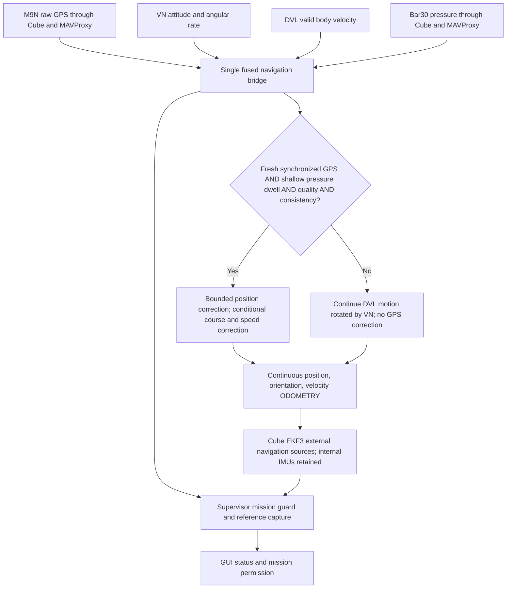

# Pressure-gated external odometry — 2026-10-11

Implemented on `tether_toggle_beichen`. No vehicle access, deployment, live
parameter changes, arming of hardware, or main changes. Supersedes the virtual
GPS experiment in single-ekf-redesign-2026-10-11.md; those results remain historical.

## Data path

`bridge_estimator.py` is a complementary estimator, not a second full inertial
EKF. Cube remains responsible for inertial fusion/control. Raw Cube position is
never fed back into the bridge. Cube geographic origin is frame metadata only.
The bridge receives external sensors once, owns GPS admission and pressure state,
and supplies one odometry stream. No GPS_INPUT or source-switch commands remain
in this experimental path. All three source slots have identical external-only
settings, so there is no underwater/surface source transition.

## Conditions and timing

- A measured surface-pressure baseline is mandatory. No automatic baseline is
  inferred at startup. Depth uses pressure difference / water density / gravity.
- Depth at or below 0.15 m continuously for 2 seconds permits GPS qualification;
  above 0.15 m immediately suspends GPS corrections. Depth at or above 0.4 m for
  2 seconds establishes submerged state. These antenna/depth thresholds require
  vehicle-specific commissioning. They do not prove the antenna is dry.
- Pressure must have increasing Cube timestamps, a matched TIMESYNC mapping,
  and age bound at most 350 ms. VN/DVL must be fresh within 500 ms, ordered,
  valid, and not old ROS queue data. Cube reboot latches a frame fault.
- GPS requires a new Cube fix timestamp, 3D fix, valid accuracy within 3 m,
  timing bound at most 350 ms, fresh VN, DVL consistency, and 3 seconds of
  continuous qualification. Repeated messages do not extend fix freshness.
- This timestamps Cube last-fix receipt, **not receiver measurement epoch**.
  Receiver delay remains unknown. TIMESYNC rejects round trips above 50 ms;
  mappings expire after 3 seconds. DVL/VN alignment remains approximate.
- A history lookup aligns GPS with propagated position. First qualified fix
  anchors NE before output starts. Later fixes must pass a bounded residual
  gate and move position by at most 0.1 m per accepted fix. Corrections never
  count as travelled distance. Rejected fixes do not reset the estimate.
- GPS course cannot determine yaw at rest. Heading correction additionally
  requires a validated mounting reference, forward speed >=0.5 m/s, low lateral
  and vertical motion, low turn rate, speed agreement, course uncertainty <=10
  degrees, residual <=15 degrees, and 3 seconds / 5 fixes of qualification.
  Correction is capped at 0.5 degrees/fix and +/-15 degrees total. Forward speed
  bias correction is bounded to +/-0.15 m/s and waits for heading agreement.
- DVL/VN continuity loss after initialization latches a fault and stops output;
  no zero-velocity substitution or silent frame restart. Pressure loss withholds
  output and GPS eligibility. Mission readiness also rejects position sigma >5 m.

## Supervisor and launch

The supervisor remains an active mission guard: checks Cube health, bridge
identity/configuration/uncertainty, validates pre-dive preparation, captures and
persists the mission reference, and grants expiring mission permission. It uses
the bridge's depth/GPS assessment rather than qualifying the sensors again.
It does not select sources or reset the bridge in continuous mode. RF/tether
failsafes and kill remain separate.

`continuous_fusion:=true` selects `fused_nav_bridge` exclusively instead of the
legacy bridge. Both use the same process-ownership key; GUI cannot start/stop
the fused executable. Default launch remains legacy observation; experimental
bridge output is disabled. An explicit commissioning configuration must supply
enabled state, surface pressure, validated heading and matching Cube parameters.
The old supervisor calibration service is not a way to calibrate this bridge.

`odometry_profile.py` requires external position XY/Z, velocity XY and yaw (6),
VELZ 0, SRC_OPTIONS 0, and origin height correction mask 0. Physical GPS remains
available for raw telemetry but is not a selected EKF measurement source. Readback
must match and stay fresh before bridge output. The bridge never writes parameters.
Internal Cube IMUs necessarily remain local to Cube; 'all sensors through bridge'
refers to the external navigation aiding path.

## Validation and discovered faults

156 Python regression tests pass, including adapter pressure/timing/sender checks,
GPS rejection/recovery, continuous dead reckoning, origin changes, heading and
speed gates, profile expiry, restart faults, and existing mission/GUI regressions.
ROS Humble colcon build and Node supervisor rendering tests pass.

Native isolated ArduSub SITL (`sitl/validate_bridge_odometry.py`) uses owned sysid
42, local TCP5864, and no QGC forwarding. It provides independent stationary
DVL/VN measurements and prescribed pressure depth, not Cube-estimate feedback.
It arms only the owned simulator. Committed JSON results include failed runs.

Initial run stopped on origin change and incomplete one-shot parameter readback.
Repeated readback resolved the transport omission. Inspection showed the origin
change was altitude-only (0 to -0.17 m), not a horizontal frame reset. The bridge
and continuous supervisor now tolerate altitude metadata changes because NE uses
only lat/lon and depth uses the pressure datum. Horizontal changes still fault.
See ArduPilot's [origin-height behavior](https://ardupilot.org/copter/docs/parameters-Copter-stable-V4.1.0.html#ek3-ogn-hgt-mask-bitmask-control-of-ekf-reference-height-correction).

Final native run passes: 113 fixes accepted at surface; zero fixes accepted during
the submerged ~50 m raw GPS jump and GPS outage; 34 accepted on reacquisition.
ODOMETRY continued in every phase, Cube horizontal validity remained available,
and stationary horizontal estimate stayed approximately 1 cm from origin.
This addresses the previous prototype's loss of horizontal validity during outage.

## Not yet commissioned

- Native test calls the estimator directly, not the complete ROS/DDS adapter.
  Adapter callbacks have mocked-transport tests; an end-to-end ROS/native test
  and moving dive/waypoint dynamics are still required before deployment.
- Covariance growth, gains, gates, offsets and water density are provisional.
  Position/velocity correlation is not fully modeled; this is not an accuracy claim.
- The existing operator-requested VN mounting offset was preserved, not verified.
- No surveyed map accuracy, physical GPS accuracy, heading accuracy, or actual
  vehicle firmware/profile compatibility was established in these tests.
- Bridge restart, missing DVL lock, and significant GPS disagreement require
  revalidation; automatic in-mission recovery is deliberately not implemented.
- Surface calibration/configuration must be integrated into commissioning before
  enabling the new runtime. Live waypoint execution remains uncommissioned.

Fix demonstrated bugs during testing and retain failed-run evidence. Do not
relax a gate merely to make a test pass. No live mission should use this prototype
until the outstanding integration and vehicle checks above are completed.
