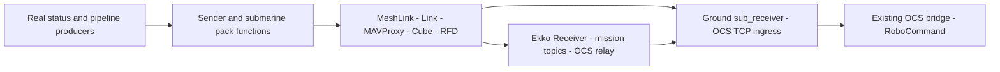
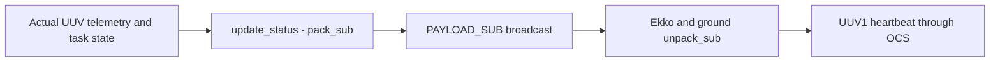
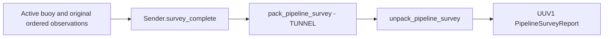
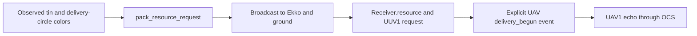

# GRAEY Task 2 Communications

Local implementation and documentation updated November 1, 2026

Local only. No push or vehicle deployment.

## 1. Architecture and responsibility

GRAEY reports its UUV status, ordered pipeline survey, and resource request. The
same broadcast can reach Ekko and ground. Ekko decodes submarine data separately
from Crusader's boat map and exposes the colors to delivery software. Ground
converts the reports through the existing OCS bridge; only that bridge publishes
to RoboCommand.



Ground is the Multipoint master; GRAEY, Ekko and Crusader are subnodes. GRAEY's
RFD connects through its Cube, following Ekko's hardware pattern. Crusader's RFD
connects directly to its Jetson. MAVProxy retains sole intended ownership of
GRAEY's Cube USB connection.

The code follows the team's existing split: pure `pack_*` / `unpack_*` codec,
sender timing, receive state, then ROS and OCS adapters. Submarine packets have
their own fields, without boat activities, buoy slots or map acknowledgements.
No perception, sensor collection, navigation, arming or mission execution is
added. Until real producers supply data, report slots remain empty.

| Local checkout | Main interaction |
|---|---|
| GRAEY: `robotx_graey_2026` | `api/comms/sub_link_node.py` accepts producers; `sub_link.py` packs them; `mesh_link.py` submits TUNNEL frames |
| Ekko: `rx26_uav` | `uav_fcu/telemetry_bridge.py` decodes with `uav_common/sub_link.py`; `uav_groundstation/ocs_client_node.py` relays reports |
| Ground: `rx26_ocs` | `fleet/sub_receiver.py` decodes radio traffic; `rx_bridge/bridge.py` validates and publishes official reports |

The table abbreviates inner Python package directories. For example, GRAEY's
codec is `robotx_graey_2026/api/comms/sub_link.py` relative to its repository.
Ekko's and ground's codec copies are byte-identical to that canonical codec.

<!-- pagebreak -->

## 2. Comparison with Crusader and Ekko

The radio transport and codec pattern are shared. The submarine's packet
contents and application integration are specific to GRAEY and Task 2.

| Aspect | Existing boat and drone | Submarine implementation |
|---|---|---|
| Transport | Standard MAVLink 2 TUNNEL over the RFD900ux Multipoint network | Same transport and broadcast destination convention |
| Software pattern | Pure `pack_*` / `unpack_*` helpers, sender timing and receiver state | Same split in `sub_link.py`, with submarine-specific fields |
| Physical connection | Crusader RFD connects to Jetson; Ekko RFD connects through Pixhawk and MAVProxy | Cube and MAVProxy path, matching Ekko's hardware |
| ROS integration | Crusader uses `rfd_link_node`; Ekko uses its single `telemetry_bridge` | A separate `sub_link_node` uses GRAEY's existing shared `Link` and dedicated MAVProxy endpoint |
| Status contents | Boat position, activity, target buoy slot and map acknowledgements | UUV position, speed, attitude, altitude/depth, robot state and current task |
| Mission products | Drone buoy-position map, beacon states and GNSS quality | Active buoy and ordered pipeline conditions; resource-tin and delivery-circle colors |
| Repetition | Boat reports and drone lights at 1 Hz; unacknowledged positions can repeat after 3 s, with a full map refresh every 10 s | While enabled: fresh status at 2 Hz and survey/resource every 3 s; submerged phase holds application packets; no application acknowledgement |

### From boat packing to submarine packing

`pack_boat()` carries boat latitude/longitude, activity, target slot, map-slot
acknowledgements and optional map epoch. `pack_sub()` follows the same binary
packing approach but carries the UUV heartbeat fields. Pipeline conditions and
colors have separate pack/unpack functions, because they are separate Task 2
reports. No submarine meaning is assigned to the boat's target-slot or map-ack
fields.

The existing boat/map payload types remain intact. GRAEY adds 32775 for submarine
status, 32776 for the pipeline survey, and 32777 for the resource request. All
three use ordinary TUNNEL frames rather than a new MAVLink dialect.

### Additions made for this integration

The version/run/session/sequence header and OCS direct-versus-relayed copy
deduplication are new additions, not fields inherited from `pack_boat()`.
They identify a GRAEY report when both ground and Ekko forward the same packet.
The separate OCS task-event queue is also new: it prevents a survey or resource
request from being replaced by the next latest-wins heartbeat.

Ekko's submarine topics and explicit delivery-begun/ended reporting hooks are
new adapters. They expose GRAEY's data and report actual UAV delivery transitions;
they do not implement retrieval, flight or delivery behavior. The real pipeline
mission still supplies the observations. These are local code differences,
not verified differences in deployed vehicle software.

<!-- pagebreak -->

## 3. Underwater delivery and irrelevant messages

The mission supplies `/graey/comms/submerged` (`std_msgs/Bool`). True pauses
UUV application packet offers; false resumes them. This is a communications
phase supplied by the mission, not inferred from a radio dropout or a guessed
depth threshold. It does not change flight-controller telemetry, radio power,
navigation, arming or kill/failsafe selection.

| Phase | GRAEY behavior | Ekko and ground behavior |
|---|---|---|
| Surface before descent | Send current supplied task/status information | Receive UUV task initiation and fresh status |
| Submerged task | Keep latest local status; save actual survey and resource products to the outbox | UUV telemetry can go stale; do not invent fresh heartbeats or declare the task finished |
| Surface again | Immediately offer retained survey/resource packets; send status only if its producer is fresh | Decode retained observations, deduplicate direct/relay copies, report through OCS |

`Sender.set_submerged()` implements the phase. Survey and resource products are
journaled with atomic file replacement before being queued. The ROS node's
`outbox_path` defaults to `/root/robotx_ws/logs/sub-comms-outbox.json`. Tests use
temporary files; no onboard file was created. With no saved phase, reporting is
enabled initially; the mission must supply its phase before descent.

A process restart restores the saved run, phase and survey/resource bytes with
their original event identities. It does not restore old heartbeat samples.
A new sender session identifies newly produced data. An explicit new run clears
the previous run's products. Outbox errors are visible instead of silently
claiming the report was saved. This is process-restart recovery, not a tested
guarantee against storage hardware failure.

Retained products repeat every three seconds after surfacing until the run
changes. Without an acknowledgement, a transmit attempt is not proof of receipt.
The UUV's ground and Ekko relay queues expire waiting heartbeats after one
second, keeping an OCS reconnect from reviving old status.

### Application dispatch on the shared mesh

Crusader's passage handler accepts only Ekko POSITIONS and LIGHTS packets.
Submarine status, survey and resource packets can be logged but cannot refresh
its map-health timer, mark its map heard, or change passage state. GRAEY's typed
receiver accepts only submarine packet types; a BOAT packet cannot change UUV
status or resource state. Ekko keeps boat and submarine handlers separate.
Ground retains its reporting roles for both vehicles.

Raw diagnostic receipt is separate from mission use: hearing/logging a frame
does not mean applying its contents. Mesh transport remains shared.

The Task 2 rules permit surfacing to report results. The separate 2 Hz heartbeat
requirement cannot create an underwater RF path: fresh UUV reporting during the
blackout remains unavailable in this RF-only design. The software does not
synthesize heartbeats during that gap, and queued UUV heartbeats expire as
described above. Competition handling still needs confirmation.

<!-- pagebreak -->

## 4. Submarine packets and encoding

Packets use standard MAVLink 2 TUNNEL, message 385. Destination defaults to
system/component 0/0 for broadcast. The actual byte count goes in
`payload_length`; padding fills the 128-byte TUNNEL field. `MeshLink` defaults
to application identity 43/191 and MAVProxy UDP 14601. These do not change a
radio NODEID or the Cube's ID.

| Payload type | Pack and unpack functions | Application bytes |
|---|---|---|
| 32775 `PAYLOAD_SUB` | `pack_sub()` / `unpack_sub()` | 47 |
| 32776 `PAYLOAD_PIPELINE_SURVEY` | `pack_pipeline_survey()` / `unpack_pipeline_survey()` | 22 + segment count |
| 32777 `PAYLOAD_RESOURCE_REQUEST` | `pack_resource_request()` / `unpack_resource_request()` | 15 |

Every packet starts with `_HEADER = struct.Struct('<BIII')`: version (1 byte),
run ID (4), sender-session ID (4), and sequence (4). Fields are little-endian.
New publications use a new sender session after restart; restored mission
products retain their original session/sequence. The run comes from the real
run coordinator. These identify direct and relayed copies of the same report.
They are team-local metadata; the OCS assigns official report sequences and
publication times independently for each vehicle.

### Status body

`_SUB = struct.Struct('<ii6fBB')` contains:

| Fields | Representation | Meaning |
|---|---|---|
| Latitude, longitude | Two int32 | Degrees multiplied by 10^7 |
| Speed, heading | Two float32 | m/s and degrees |
| Roll, pitch | Two float32 | Degrees; NaN means absent and is omitted from the report |
| Altitude HAE, depth | Two float32 | Meters from the real producer |
| Robot state, current task | Two uint8 | Official enum values |

`unpack_sub()` reconstructs a `TYPE_UUV` heartbeat. Its task field carries the
transition into `TASK_INFRA_SURVEY_REPAIR` and later `TASK_NONE`. No vehicle
start/arm command is derived from that field. Mandatory measurements must be
supplied rather than replaced with placeholder coordinates or depths.

<!-- pagebreak -->

## 5. Survey and resource wire conventions

Both reports use pure struct packing, the common 13-byte header, standard
TUNNEL framing, and matching unpack functions at Ekko and ground. The submerged
outbox stores the exact packet bytes; surfacing does not change their meaning.

### Pipeline survey

`pack_pipeline_survey()` / `unpack_pipeline_survey()` use payload type 32776.
After the common header, `_SURVEY = struct.Struct('<iiB')` stores the active
buoy coordinates and count, followed by one byte per observed segment.

| Byte offset | Field | Encoding and meaning |
|---|---|---|
| 0-12 | Common header | Version, run ID, sender session ID, sequence |
| 13-16 | Active buoy latitude | Little-endian signed int32, degrees times 10^7 |
| 17-20 | Active buoy longitude | Little-endian signed int32, degrees times 10^7 |
| 21 | Segment count N | uint8; number of observed segment conditions |
| 22 onward | Ordered conditions | N uint8 values: 1=INTACT, 2=DAMAGED |

Total application length is **22 + N bytes**, at most 128 bytes (106 segments).
Index zero is the segment nearest the active green buoy. The list preserves
the original survey observations, including a segment observed DAMAGED before
repair. It is not a list of post-repair conditions.

The reconstructed OCS body is `pipeline_survey`, containing
`active_buoy_position` with `latitude`/`longitude`, and `segments` using
`PIPELINE_SEGMENT_INTACT` / `PIPELINE_SEGMENT_DAMAGED` enum names. It becomes
the official `PipelineSurveyReport` attributed to UUV1.

### Resource delivery request

`pack_resource_request()` / `unpack_resource_request()` use payload type 32777.
After the common header, `_RESOURCE = struct.Struct('<BB')` stores:

| Byte offset | Field | Encoding and meaning |
|---|---|---|
| 0-12 | Common header | Same version/run/session/sequence convention |
| 13 | Resource tin color | uint8: RED=1, GREEN=2, BLUE=3, ANY=4 |
| 14 | Delivery-circle color | uint8: RED=1, GREEN=2, BLUE=3 |

Total application length is **15 bytes**. For Disruptive, the first observed
flash supplies byte 13 and the second supplies byte 14. For Advanced, the tin
is ANY and the observed flash supplies the circle. ANY is not a circle color.

The reconstructed `resource_delivery` body contains
`task=TASK_INFRA_SURVEY_REPAIR`, `resource_color`, and `delivery_circle_color`.
It becomes `ResourceDeliveryRequest`. GRAEY reports it as UUV1; Ekko echoes the
same colors as UAV1 only when its delivery mission explicitly begins.

Existing and retired boat/map payload numbers are unchanged. None of these
format definitions acquires a buoy position, segment condition or color.

<!-- pagebreak -->

## 6. Status and pipeline survey flows



1. Real status software supplies a complete heartbeat dictionary to `Sender.update_status(heartbeat, now)` or its ROS input.
2. `pack_sub()` converts coordinates and fields into the submarine layout.
3. `Sender.due()` emits fresh supplied status at 2 Hz, with a new sequence for each heartbeat publication. If its producer stops updating for over a second, cached status stops transmitting.
4. `SubLinkNode._tick()` calls `MeshLink.send_tunnel()`, which uses the existing `Link.send('tunnel_send', ...)` through MAVProxy and Cube.
5. Ekko's `TelemetryBridge._sub_received()` and ground's `forward_tunnel()` use `Receiver.hear()` and `unpack_sub()` to recover the same fields.
6. Both paths can submit a UUV1-attributed heartbeat to the OCS. Its official `current_task` reports Task 2 initiation.



The pipeline mission supplies the active green buoy position and the original
survey results, ordered from the segment nearest that buoy. Communications
preserves list order. Repairing a segment does not cause this layer to rewrite
its original DAMAGED observation as INTACT.

At the mission's applicable survey/repair completion point, it calls:

```python
sender.survey_complete(active_buoy_position, ordered_observed_segments)
```

The receiver reconstructs `pipeline_survey.active_buoy_position` and `segments`
using official JSON field names. The OCS parses them into
`PipelineSurveyReport`. No repair action or repair-success inference runs here.

<!-- pagebreak -->

## 7. Resource colors and UAV delivery echo



The real pipeline mission decodes the flashing lights after repair. It supplies
those results to the sender; communications does not find the pipeline, read a
camera, classify lights, or invent a resource request.

```python
# Called by real mission software after obtaining the observation.
sender.resource_observed(resource_color, delivery_circle_color)
```

`pack_resource_request()` stores the colors in their observed roles.
`unpack_resource_request()` reconstructs `task`, `resource_color`, and
`delivery_circle_color` for the official `ResourceDeliveryRequest`.

| Tier | GRAEY report input | Reporting result |
|---|---|---|
| Core | Active buoy and original ordered segment conditions | UUV1 pipeline-survey report |
| Advanced | Tin `COLOR_ANY`; observed destination circle | UUV1 resource request with a specific circle |
| Disruptive | Observed tin color, then observed circle color | UUV1 resource request preserving both colors |

Ekko publishes the decoded request on `/uav/sub/resource_request`. Its delivery
mission can consume it directly. Merely receiving the request does not claim
delivery has begun. When that mission actually starts delivery, it publishes
the received request's run/session/sequence reference on
`/uav/task2/delivery_begun`.

`TelemetryBridge._sub_delivery_begun()` calls `Receiver.delivery_begun()`.
That method references the stored request and builds the same color report
attributed to UAV1. Ekko sends that event on its existing UAV reporting
connection. Receipt, GRAEY's request, and Ekko's delivery-begun echo are separate.

That explicit delivery event also sets Ekko's reported current task to Task 2.
The real delivery mission publishes `/uav/task2/delivery_ended` when it finishes
or stops; Ekko then returns its heartbeat task to NONE. A new RunStart clears
the delivery reporting state. None of these reporting hooks commands the aircraft.

### Direct and relayed copies

`ocs_envelope()` wraps the official report dictionary with team-local event
identity. Ekko forwards UUV1 reports on a separate UUV connection; ground can
submit the same radio packet directly. `Bridge._on_sub_frame()` checks its run
and deduplicates the copies before existing validation, rate governing,
per-vehicle sequencing and protobuf publication. UUV1 and UAV1 remain distinct
reports even when referencing the same resource observation.

<!-- pagebreak -->

## 8. Producer hooks and file interactions

The local ROS entry point is `sub_link_node`. It is not automatically added to
navigation startup. Real producers connect through these inputs:

| GRAEY input | Message | Supplied content |
|---|---|---|
| `/graey/comms/run_id` | `std_msgs/UInt32` | Actual run ID; a change clears cached products |
| `/graey/comms/submerged` | `std_msgs/Bool` | Actual mission phase: true holds reports, false resumes them |
| `/graey/comms/status` | `std_msgs/String` JSON | Actual heartbeat fields, including current task |
| `/graey/comms/pipeline_survey` | `std_msgs/String` JSON | Active buoy position and ordered `segments` |
| `/graey/comms/resource_request` | `std_msgs/String` JSON | `resource_color`, `delivery_circle_color` |

Status fields are `position` with `latitude` and `longitude`, `state`,
`current_task`, `spd_mps`, `heading_deg`, `altitude_hae_m`, and `depth_m`.
`roll_deg` and `pitch_deg` are optional. Mission software supplies the actual
run ID and owns the survey/repair and resource-observation reporting times.
JSON uses official enum names: `STATE_AUTO`, `TASK_INFRA_SURVEY_REPAIR`,
`PIPELINE_SEGMENT_INTACT` / `PIPELINE_SEGMENT_DAMAGED`, and `COLOR_RED` /
`COLOR_GREEN` / `COLOR_BLUE` (or `COLOR_ANY` for an Advanced-tier tin).

| File | Interaction |
|---|---|
| GRAEY `sub_link_node.py` | `_input()` fills Sender slots; `_tick()` sends only due populated packets |
| GRAEY `sub_link.py` | Pure codecs, `Sender`, `Receiver`, `ocs_envelope()` |
| GRAEY `mesh_link.py` and `mavlink.py` | TUNNEL framing, UDP, component heartbeat and bounded receive drain |
| Ekko `telemetry_bridge.py` | Publishes decoded `/uav/sub/status`, `/uav/sub/pipeline_survey`, `/uav/sub/resource_request` and `/uav/sub/ocs_report` |
| Ekko `ocs_client_node.py` | Routes UUV reports and explicit UAV delivery events to the OCS |
| Ground `fleet/sub_receiver.py` | Decodes UDP 14602, logs products, forwards to local OCS TCP 37564 |
| Ground `rx_bridge/sub_reports.py` | Identifies direct/relay duplicates and mismatched runs |

The OCS-link helper keeps heartbeats latest-wins and queues task events
separately. A survey or resource request cannot be overwritten by the next
heartbeat. Failed event writes remain queued. Cached actual survey/resource
packets repeat every three seconds until the run changes; the OCS deduplicates
accepted copies. No remote-delivery acknowledgement is claimed.

GRAEY exposes parsed frames on `/graey/comms/received` for diagnostics.
Application dispatch ignores irrelevant boat/sub packets as described in
Section 3; it does not remove those frames from the shared radio transport.

<!-- pagebreak -->

## 9. Local operation and verification

These entry points are prepared locally for later integration. None was started
on a vehicle or against actual competition systems for this work.

```bash
# GRAEY: installed package and existing MAVProxy output UDP 14601 available.
ros2 run robotx_graey_2026 sub_link_node

# Ground: existing fleet_link owns the master radio and provides UDP 14602.
python -m fleet.sub_receiver
```

Ekko's existing telemetry bridge and OCS client contain the receive/relay
callbacks in the local `rx26_uav` checkout. Ground's local `fleet.toml` adds a
dedicated listen-only decoder output, preserving existing GUI and QGC outputs.
The existing OCS TCP and RoboCommand MQTT paths are reused. Vehicles do not
connect directly to RoboCommand.

### Offline results

| Check | Verified locally |
|---|---|
| Codec and producer tests | 15: existing packet semantics plus submerged hold/resume, durable products/phase, restart recovery, run reset and visible outbox failures |
| Cross-repository integration | 12: existing report flow plus underwater restart/surface delivery, boat/sub application isolation, and queued UUV heartbeat expiry |
| Lower transport tests | 10 tests passed |
| Crusader link regressions | 14 tests passed; one full ROS loopback test requires the ROS container |
| Existing OCS bridge regressions | 121 tests passed |
| Existing fleet regressions | 140 tests passed with the team's RobotX dialect and serial loopback dependency |
| Existing Ekko benches | Heartbeat 24/24 and radio 36/36 passed |

All observations used in tests are explicit offline fixtures. A fake publish
sink captures official protobuf bytes; no MQTT loop, vehicle, radio, sensor or
delivery mission is started. ROS callback bodies are exercised without ROS
installed. A full ROS build/runtime check and real RFD/Cube-path verification
remain part of later deployment.

The pure codec is copied unchanged into GRAEY, Ekko and ground, and tested for
copy equality. No repository push, GRAEY deployment, radio flashing, parameter
change or vehicle service restart was performed.

The local `rx26_asv` checkout includes the passage-handler and map-state guards
for irrelevant packets. No Crusader deployment was performed.

Physical RFD port/firmware, fleet identities and radio forwarding still need
commissioning. An earlier Cube read showed ID 1 and MAVLink 2 telemetry ports;
that is not proof of wiring or RF traffic. The producer hooks are implemented,
but the real pipeline mission must supply observations and real run/status values.

### Official references

- [Task 2 survey, repair and resource sequence](https://robonation.gitbook.io/robotx-2026-team-handbook/section-3-autonomy-challenge/3.3-mission-task-descriptions/3.3.3-mission-task-2-infrastructure-survey-and-repair)
- [OCS communications and reporting](https://robonation.gitbook.io/robotx-2026-team-handbook/section-3-autonomy-challenge/3.4-communications-protocol)
- [Official report definitions](https://github.com/robonation/robocommand/blob/main/RobotX_2026/proto/robotx/rx_reports.proto)

The supplied example informed the layout and explanation style. This document
covers GRAEY's implemented local packet definitions and adapters.
