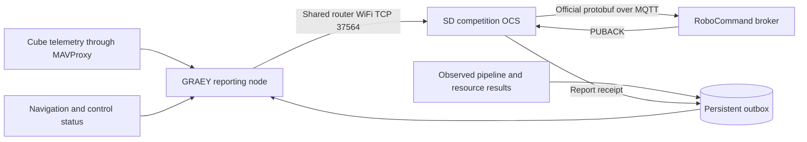

# GRAEY competition WiFi integration

**Current upstream update:** See [current fleet adaptation](current-fleet-adaptation-2026-11-09.md) for the laptop GCS bridge, automatic OCS discovery, native run snapshots, tier controls and current-main compatibility patch. That guide supersedes the earlier SD-only startup/snapshot instructions below.

GRAEY and the laptop join the same router or hotspot. GRAEY initiates a TCP connection to the laptop OCS on port 37564. The OCS remains the only connection to RoboCommand. This implementation follows the November 7 SD-card competition source; GRAEY RFD integration is deferred. The subsequent [operator and gateway standardization](operator-standardization.md) adds the fleet-style GUI, shared ROS FCU gateway and competition-only RunStart workflow.



The reporting node reports measured state and observations. Receiving a run ID updates its bookkeeping; that node never arms GRAEY, resets a fault or restores ESC power. The mission node separately uses verified RunStart to release an explicitly selected competition mission from autonomous hold. Ekko target reception is outside this implementation.

## Start the laptop OCS

The development workspace contains `competition-comms/OCS`, copied from the SD source. Its GRAEY changes are also packaged in `docs/competition-ocs.patch` for applying to the corresponding OCS source later. The older `rx26_ocs` directory was preserved.

The patch passed a read-only `git apply --check --ignore-space-change` against that extracted baseline. Review it in the intended OCS checkout before applying; it is separate from the GRAEY package build.

Use the OCS Python environment with its pinned `requirements.txt`, then run from the OCS directory:

```powershell
python -m ocs_web --config bridge.toml
```

Open the normal OCS page at `http://127.0.0.1:8099`. This command starts the competition OCS without launching `fleet_link` or opening its RFD serial port. The original UAV/boat configuration remains available separately.

Find the laptop IPv4 address on the shared router using `ipconfig`. GRAEY must reach that address on TCP 37564; router client isolation and the laptop firewall must permit that connection. Use the laptop's team WiFi address, rather than its RoboCommand course-facing address. The SD bridge already listens on `0.0.0.0:37564`.

## Start the GRAEY node when hardware is available

Build the updated GRAEY package in the existing ROS Humble container. Keep MAVProxy as the sole Cube serial owner. The standardized core gateway owns its local output on UDP 14551; reporting receives FCU telemetry through ROS. The former per-consumer UDP output 14601 is no longer used by this production path.

```bash
cd /root/robotx_ws
colcon build --packages-select robotx_graey_2026 --symlink-install
source install/setup.bash
ros2 launch robotx_graey_2026 comms.launch.py \
  ocs_host:=LAPTOP_WIFI_IP \
  outbox_path:=/root/robotx_ws/logs/competition-outbox.sqlite3
```

Replace `LAPTOP_WIFI_IP` with the address found above. Keep the outbox on persistent storage across container restarts. The node is opt-in; core can start it with `communications_enabled:=true ocs_host:=LAPTOP_WIFI_IP`. Stop the older `sub_link_node` and manual mesh probes before using this endpoint. A process lock rejects a second competition node in the same runtime scope.

Inspect its live state:

```bash
ros2 topic echo /graey/comms/status
```

`wifi.connected` means the TCP connection is open. `run_confirmed` means the OCS has recently confirmed a running competition run. `pending`, `broker_acknowledged` and `rejected` describe observation delivery. `telemetry_hold_reason` explains a withheld heartbeat. An MQTT broker acknowledgement confirms broker receipt, not a competition score or task acceptance.

## Telemetry and mission observations

The node reads the existing local MAVLink stream and the navigation/control ROS topics. It uses the current geographic transformation for position, horizontal velocity for speed, attitude for heading/roll/pitch, fresh navigation pressure depth, and fresh GPS ellipsoid altitude for HAE. It does not substitute mean-sea-level altitude or Ekko's geoid constant. Missing HAE, stale Cube control state or invalid navigation suppresses heartbeat transmission. Commanded ESC permission and the software failsafe inform the reported killed state; they do not sense the physical reed switch.

Valid heartbeats transmit at 2 Hz while the navigation bridge reports GRAEY surfaced. Submerged, unknown or stale surface state pauses report transmission. Observations remain in SQLite and resume when surfaced and the OCS confirms the matching run. Restarting never restores a cached permission to transmit. This implements the chosen connection policy; it does not establish competition acceptance of submerged heartbeat gaps.

The transport accepts real observation results through these `std_msgs/String` topics:

| Topic | JSON content |
| --- | --- |
| `/graey/comms/current_task` | Plain enum string, such as `TASK_INFRA_SURVEY_REPAIR`; defaults to `TASK_NONE`. |
| `/graey/comms/pipeline_survey` | `observation_id`, `active_buoy_position` with `latitude` and `longitude`, and ordered `segments`. |
| `/graey/comms/resource_request` | `observation_id`, `resource_color`, `delivery_circle_color`. |

For pipeline segments, 1 means intact and 2 means damaged, in physical survey order; one to eight segments are accepted by the SD format. Resource colors are 1 red, 2 green, 3 blue; the delivery circle also supports 4 ANY. These become the SD system's official `pipeline_survey` and `resource_delivery` protobuf bodies.

Each observation needs a stable ID within its competition run. Repeating an ID with identical contents is idempotent; changing its contents is rejected. A pipeline recorder saving camera/sonar data does not itself classify pipeline conditions. Its eventual perception/mission producer must publish verified conditions through these topics; this pass does not invent detections from recordings.

The competition mission node publishes its current task periodically. Other task producers must refresh their claim within two seconds; a stale claim or manual takeover reports `TASK_NONE`.

## Reconnects and receipts

The WiFi client reconnects automatically and refreshes the OCS run snapshot every two seconds. Heartbeats are live samples and are never queued. Task reports keep their sequence and timestamp across retries and process restarts. The OCS retains authority over the external sequence and send timestamp.

A `published` receipt keeps an observation pending. Only `acknowledged`, sent after broker PUBACK, marks it delivered. Held/dropped reports remain visible as rejected, with their details retained in SQLite. Previous-run pending observations stay stored and are excluded from a different run. A run-tagged GRAEY envelope lets the OCS reject a mismatched run before external publication; the envelope is removed before protobuf conversion.

At most 2,048 pending observations are admitted; reaching that limit refuses a new observation without erasing existing ones. Retain the database for reviewing rejected or previous-run reports. The SD bridge deduplicates resends in memory; a complete OCS restart can cause another QoS 1 delivery. This is persistent retry with broker receipts, not an exactly-once guarantee across every process failure.

## Local verification

The workspace `competition-comms/verify.py` records unit, SD OCS and fleet regression results in `verification.json` and individual logs. The GRAEY repository also contains portable unit tests in `test/test_competition_comms.py` and an isolated ROS wiring test in `test/ros_competition_smoke.py`. The latter feeds synthetic MAVLink frames through the real ROS FCU client and opens only a local TCP fixture.

Local tests cover underwater retention, stale telemetry, measured depth, ordered pipeline conditions, colors, run mismatch, restart/reconnect, duplicate suppression, and real local MQTT PUBACK receipts. Hardware WiFi, actual telemetry availability, producer integration and on-water behavior still need commissioning when GRAEY becomes available. No vehicle deployment or online push is included in this development pass.

Final results: 27 GRAEY unit tests, 585 OCS tests with two skips, 533 fleet tests with one skip, and seven focused WiFi integration tests passed. The final ROS Humble smoke also passed with measured depth and both observation types reaching its local TCP fixture.
