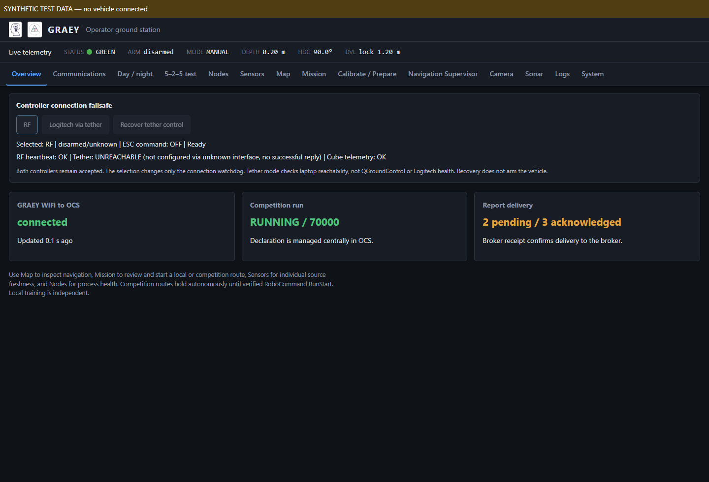

# GRAEY operator and gateway standardization

**Unified operator update:** [Missions, Sensors and Record guide](unified-operator-guide.md) supersedes the earlier separated Map/Mission/5–2–5 workflow and Communications-tier location. Declare/End now use the shared OCS API from Missions.

**Current upstream update:** See [current fleet adaptation](current-fleet-adaptation-2026-11-09.md) for the laptop GCS bridge, automatic OCS discovery, native run snapshots, tier controls and current-main compatibility patch. That guide supersedes the earlier SD-only startup/snapshot instructions below.

This local implementation follows the SD-card Crusader/Ekko operator conventions and Crusader's FCU gateway structure. MAVProxy remains the sole Cube serial owner. One ROS `telemetry_gateway` owns its UDP connection; production navigation, controller, LED, GUI and reporting consumers use ROS topics through the existing `Link` API.

## Operator interface

The existing ground station remains at port 8090. It provides Overview, Nodes, Sensors, Map, Mission, preparation/calibration, navigation supervision, Camera, Sonar, Communications, Logs and System. Shared offline assets provide fleet branding, system typography, tabular numbers, consistent buttons, status colors and per-browser day/night preference.

Overview shows controller failsafe controls, GRAEY WiFi to OCS, competition run and report delivery. Communications adds RF/tether observations, verified run status, gateway counters, heartbeat holds, queued/rejected/previous-run observations and individual broker receipts. Stale or missing status becomes unknown; a delayed ROS snapshot does not acquire a new source timestamp.

Map and Mission retain the submarine route tools. Camera streaming is opt-in and suspends when its tab or browser is hidden; this changes the viewer, not recording. Logs use bounded incremental reads and handle file rotation/truncation. System reads CPU, memory, thermal-zone, disk and uptime measurements; unsupported readings remain unknown.

## Competition workflow

1. Join GRAEY and the laptop to the same router/hotspot and start the SD-derived laptop OCS.
2. Inspect fresh navigation, controller/ESC permission and sensor state. Prepare and review the route using the existing controls.
3. Select **Competition mission** and start the reviewed route. Existing commissioning/arming checks still apply. After entering GUIDED and arming under those checks, the mission holds position and reports `WAIT_RUN_START`.
4. Declare the fleet centrally in OCS. GRAEY does not declare separately. The OCS accepts RoboCommand RunStart only when it matches its declaration; GRAEY receives its verified run snapshot through WiFi.
5. Fresh verified RunStart and current readiness release the mission from hold. A latched run continues through a submerged communication gap; a fresh end/different-run notice revokes it. Navigation faults, pilot takeover, kill and abort retain GRAEY's existing controller behavior.
6. Actual pipeline/resource observations enter the persistent outbox through the documented producer topics. They transmit when surfaced and the OCS confirms the matching run. Broker PUBACK marks delivery, not task acceptance or a score.

Local missions remain independent of RoboCommand. Raw recordings and older pipeline code that assumes unseen lights are green are not used to fabricate competition observations. No new vision classifier or repair actuation is introduced by this standardization.

## FCU ownership and modules

| Module | Responsibility |
| --- | --- |
| `api/pixhawk/telemetry_gateway.py` | Sole production ROS connection to MAVProxy, stream-rate ownership, RX distribution, TX admission and status. |
| `api/pixhawk/gateway_core.py` | Testable ArduSub command ownership and freshness policy. |
| `api/pixhawk/ros_link.py` | Socket-free adapter preserving component IDs, original frames and the Link API. |
| `api/comms/competition_wifi.py` | SD OCS framing, reconnect, run matching, persistent reports and receipts. |
| `api/comms/run_gate.py` | Competition-only verified run admission. |
| `api/gui/communications_view.py` | Source-timestamped operator snapshots. |
| `api/gui/log_reader.py`, `system_info.py` | Incremental logs and read-only host measurements. |
| `config/graey_params.yaml` | Common startup defaults for gateway, sensors, controller, GUI and communications. |

The gateway publishes `/graey/fcu/rx` plus independently arriving pose/attitude/status/RC snapshots. It receives `/graey/fcu/tx` and exposes `/graey/fcu/gateway_status`. Source timestamps and bounded queues prevent cached frames being refreshed indefinitely. The gateway owns stream rates, including all three selectable pressure messages; consumers cannot compete over those rates.

Odometry belongs to navigation. Motion belongs to the mission component and requires fresh controller permission and an armed vehicle. Read-only GUI/LED components cannot drive. Emergency disarm/release remain possible with stale control status; ESC relay commands remain assigned to the controller. Parameter writes are not admitted through this production gateway. This is ownership within a trusted ROS graph, not authentication against a hostile ROS participant.

MAVProxy's production script exposes only local UDP 14551 to this gateway, retaining its QGC/network forwarding. Legacy direct bench tools are not production consumers: use GUI/services while core runs. A standalone maintenance tool documented to require core stopped must not run concurrently with the gateway. Isolated SITL retains its explicit direct transport and domain checks.

## Startup

Build the package in the existing ROS Humble workspace, then launch core with WiFi reporting:

```bash
ros2 launch robotx_graey_2026 core.launch.py \
  communications_enabled:=true ocs_host:=LAPTOP_WIFI_IP
```

Retain the already commissioned navigation/mission launch overrides. Their safe defaults remain unchanged; this command does not grant commissioning or turn on odometry/mission execution. `params_file:=/path/to/graey_params.yaml` selects a reviewed configuration. The separate `comms.launch.py` remains available when core is already running; do not launch a second reporting node. Gateway endpoint/stream settings are startup-only.

A future hardware installation must update consumers, gateway, configuration and MAVProxy startup together with the vehicle stopped/disarmed. Do not mix old UDP-consuming nodes with the new core. No hardware services or parameters were changed. Deployment and online push wait for the user.

## Verification

The parent workspace's `competition-comms/` holds verification records, SD-derived OCS, screenshots and isolated build artifacts. The ROS gateway smoke uses a synthetic UDP autopilot and real ROS consumers to verify RX, flight mode, odometry, rejection of reader/stale motion, and emergency disarm. The reporting smoke uses actual ROS FCU transport and synthetic MAVLink frames through to native TCP reports. OCS integration also uses a real local MQTT broker for PUBACK receipts.

Browser tests render the actual ground station/control panel with labeled synthetic snapshots and check communications/outbox, day/night, camera opt-in/suspension, incremental logs, System, stale state and mobile layout. Package compilation and installed launch argument discovery are checked separately. Retained navigation fixtures now exercise the existing manually registered Cube-NED/GUIDED interface and controller bounds; production navigation tuning was preserved.

Final results: the GRAEY suite (427 tests), SD OCS suite (585 tests) and fleet suite (533 tests) passed, with platform/optional skips recorded in the logs. Linux/ROS contract suite (11 tests), gateway/reporting smoke tests, browser checks, package build and installed launch discovery also passed. The installed source/assets matched 111 files. The [repository verification record](validation/operator-standardization-2026-11-09.json) preserves the results and source hashes.

The preview below uses labeled synthetic data, rather than a vehicle connection.



Local checks do not establish vehicle wiring, telemetry availability, WiFi range, water performance or competition acceptance of submerged heartbeat gaps. The competition reference is the [October 23 RobotX 2026 handbook](https://robonation.org/app/uploads/sites/2/2026/10/RobotX-2026_Team-Handbook-20261023.pdf).
