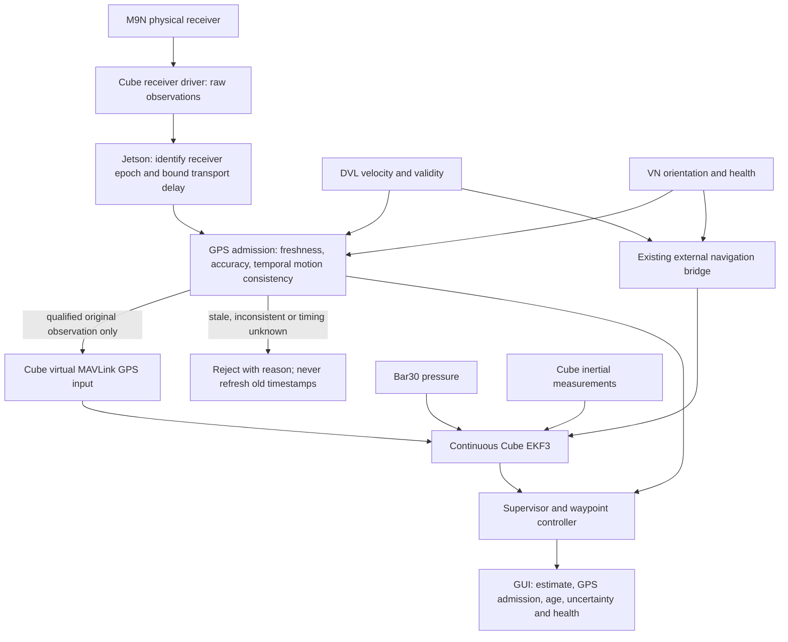

# Continuous EKF / Jetson GPS admission redesign — 2026-10-11

Status: experimental implementation added after the user accepted approximate
timing. **Not commissioned or deployed; underwater validity test fails.** See the
implementation follow-up below. The original design checkpoint follows for provenance.
The user authorized
development on `tether_toggle_beichen`, and instructed us to stop at unresolved
uncertainties rather than guess. Default launch retains legacy observation mode.

## What changes conceptually

The previous Surface/Underwater profiles select different inputs to EKF3; they
are not two separate filters. The requested replacement is one continuous fusion
configuration, with Jetson deciding whether individual GPS observations qualify.
ArduSub retains responsibility for estimation and innovation rejection.

The physical GPS must NOT also be fused directly: otherwise rejected observations
can bypass Jetson. Candidate transport is physical receiver instance 0 and virtual
MAVLink receiver instance 1, with fixed primary selection and no fallback/blending.
GPS connector number is not proof of software receiver instance numbering.

Candidate fixed horizontal position source: qualified GPS. Candidate horizontal
velocity source: external DVL; yaw: validated external VN orientation; vertical
position: barometer. This is a candidate, not an approved parameter file. Verify
continued external-velocity aiding after GPS loss on the exact ArduSub build.
Do not reset EKF origin or bridge position when GPS is rejected/reacquired.

## Timing blocker discovered during inspection

The upstream ArduPilot source inspected on October 11 sends `GPS_RAW_INT.time_usec`
from `last_fix_time_ms(0) * 1000`. That is a Cube-side fix timestamp, not evidence
of the receiver's measurement epoch. The same source sends receiver instance 0
in GPS_RAW_INT, independently of which receiver is primary.

The upstream MAVLink GPS backend uses GPS_INPUT's GPS week and milliseconds of
week for jitter correction; copying a timestamp into `time_usec` alone does not
establish the desired measurement timing. These observations are from upstream
master, **not a verification of the vehicle firmware**. Attempts to retrieve the
previously recorded short firmware revision did not resolve through the web tool.

Primary sources inspected:
- https://github.com/ArduPilot/ardupilot/blob/master/libraries/AP_GPS/AP_GPS.cpp
- https://github.com/ArduPilot/ardupilot/blob/master/libraries/AP_GPS/AP_GPS_MAV.cpp

Do not label receive time as GPS time, derive GPS week from host wall clock without
a verified mapping, or infer measurement precision from a microsecond field name.
TIMESYNC can relate host and Cube clocks but cannot recover receiver measurement
latency that the telemetry never contained. SYSTEM_TIME alone likewise cannot
associate a particular receiver measurement epoch with a particular fix.

## Required evidence before replacing the runtime

1. Resolve and pin the actual Cube/SITL firmware source. Verify GPS_RAW_INT,
   GPS_INPUT, receiver-primary selection and loss-of-fix behavior in that version.
2. Establish a supported way to transport receiver measurement epoch together with
   the exact fix: a verified existing message, or explicit firmware/receiver
   transport work. Preserve receiver time, Cube time and Jetson monotonic arrival
   separately; measure clock offset uncertainty and end-to-end delay.
3. Demonstrate in isolated SITL that unqualified native GPS cannot bypass the gate
   and a missing Jetson does not cause fallback to raw GPS.
4. Demonstrate fixed-source DVL/VN aiding through GPS loss/recovery, with estimator
   logs showing actual fusion, position continuity and no command 42007 switching.
5. Only then migrate supervisor, waypoint readiness, GUI labels, launch files and
   tests together. Keep existing software operational until replacement is proven.

## Planned code migration

- New GPS admission module/node: explicit timestamp provenance, duplicate/replay
  rejection, bounded clock uncertainty, accuracy checks, time-aligned DVL/VN
  consistency, qualified/rejected events and reasons. Never synthesize zero
  velocity or replay an old accepted position during an outage.
- `navigation_supervisor.py` / `supervisor_logic.py`: stop commanding source-set
  transitions and requesting bridge realignment. Supervise depth, aiding health,
  mission reference and estimator continuity. Surface/submerged remain physical
  states, independent of whether GPS qualifies. No GPS recovery clears kill or
  controller inhibits, arms, or restores ESC permission.
- `nav_ekf_bridge.py`: preserve existing DVL/VN transport; validate frames and
  ensure integrated external position is not independently fused as absolute GPS.
- `waypoint_logic.py`: replace Surface/Underwater source-name prerequisites with
  explicit aiding/readiness requirements. Maintain pressure-depth checks, reference
  capture, pilot takeover and failure handling.
- GUI: raw GPS, Cube estimate and GPS admission remain distinguishable. Show
  measurement age and timing uncertainty, not a misleading “GPS fused” label
  merely because Jetson forwarded it. Actual fusion needs Cube evidence.
- Launch/parameters: one exclusive GPS-gate endpoint via MAVProxy; no second Cube
  serial owner. Commissioning remains disabled until firmware and SITL proof.

## Accuracy limits and follow-up decisions

DVL/VN consistency can reject implausible changes, but cannot prove that a GPS fix
has no constant geographic offset. Stationary single-antenna GPS does not measure
body heading. Do not add another heading correction based on GPS course at rest.
The October 10 operator yaw offset remains uncommissioned; no change made here.

Questions saved for the user's return:
- If current telemetry cannot preserve receiver measurement time, approve an
  explicit firmware/receiver transport change, or accept a measured Cube-fix-time
  approximation with a stated error bound? The latter is not precise GPS epoch
  synchronization.
- What maximum timing error and position error are required? Until defined and
  measured, no claim of “super accurate” synchronization is justified.

No vehicle access, parameter writes, source commands, arming or deployment were
performed during this investigation.

Validation: the existing 134-test regression suite passed under WSL/ROS Humble
on October 11 (5.464 seconds). This is a baseline check only; no new fusion code
or single-configuration SITL run was completed. Remote tether branch was fetched
and matched local HEAD before adding this document. An initial unprivileged Git
lookup failed DNS resolution; the approved network fetch succeeded.

## Follow-up: approximate timing approved and implemented

The user's subsequent reply, “approximation is fine,” removes the receiver-epoch
blocker. Added `gps_admission.py`, `gps_gate.py`, `continuous_profile.py` and
`continuous_supervisor.py`; adapted the supervisor transport, waypoint policy and
GUI. The candidate supervisor never requests source selection or bridge realignment.
Legacy behavior is retained behind the default launch; `continuous_fusion:=true`
selects the experimental observation path. Its GPS gate remains disabled. No
vehicle parameters are automatically written and no migration is auto-enabled.

Timing contract: match TIMESYNC replies to this gate's request; accept round trips
up to 50 ms, expire synchronization after 3 s, allow fixes up to 350 ms old including
half-RTT and a small clock-drift allowance. These are provisional admission limits,
not measured hardware guarantees. They bound Cube-fix transport timing under the
clock model, not M9N processing delay. GPS week remains unknown/zero; do not invent
GPS time from the computer's wall clock. ArduPilot's configured GPS delay still
requires measurement before deployment. Approximate timing is visible in the GUI.

Admission requires 3 seconds of consecutive qualified fixes, valid fresh VN
orientation and DVL motion, and horizontal accuracy at most 3 m. The current
cross-check compares GPS displacement against DVL path length with a 2 m margin;
it is orientation-independent. VN is a freshness/validity prerequisite, **not yet
a time-aligned directional innovation test**. This is conservative admission, not
fusion/weight tuning, and cannot identify constant geographic bias.

The gate forwards original coordinates, altitude, horizontal accuracy and DOP to
virtual GPS instance 1. It omits unknown velocity, yaw and GPS epoch. GPS_INPUT must
preserve DOP: the first probe omitted it and never established horizontal position.
Physical instance-0 raw telemetry is the only accepted input; virtual GPS2_RAW and
Cube global estimates cannot loop back. Fixed primary=1, auto-switch=0 and matching
source profiles are read back before forwarding. On rejection/expiry the node
withdraws its last fix with NO_FIX and the original timestamp; it does not refresh
an old valid position. If the gate dies, backend timeout is still the fallback.

Fixed a demonstrated existing GPS-quality bug: the last trusted DVL/GPS anchor
could expire during a prolonged stationary jump, allowing the bad point to
requalify. The last anchor now persists until continuous DVL history is lost.

## Native simulation outcome: admission works, underwater readiness does not

Evidence: `docs/evidence/continuous-gps-2026-10-11/disarmed.json` and `armed.json`.
Both used an owned ArduSub process, sysid 42, TCP 5864, no QGC forwarding, no real
vehicle access. Synthetic stationary external odometry; this was not a dive or
waypoint dynamics test. Only the second run armed the simulator, confirmed by its
heartbeat; no force-arm command was used.

- Acquisition established LOCAL_POSITION_NED and EKF flags 831 after preserving DOP.
- Injected approximately 50 m of GPS error while DVL stayed stationary. The gate
  rejected it and virtual GPS lost fix; the global estimate did not jump to raw GPS.
- Restoring GPS requalified and restored flags 831.
- During the 20-second rejection, flags became **39**, with neither horizontal
  position-valid bit (8 or 16), even in the confirmed-armed run. Local coordinates
  were still emitted; their presence is NOT proof of usable waypoint navigation.
- The first disarmed result's `passed:true` refers to the earlier admission-only
  assertion. The test was strengthened afterward. The armed result explicitly has
  `admission_passed:true`, `underwater_position_status_passed:false`, `passed:false`.

An earlier exploratory run used /tmp evidence, which was not available after WSL
exited. It failed; its observed startup lacked horizontal position and omitted DOP.
Subsequent runs persist evidence under the workspace. Do not claim its full logs
were retained. The first injected glitch also used the wrong units (degrees instead
of metres); corrected to 0.00045 degrees for the retained runs.

Final software regression: 145 Python tests passed, including duplicate/stale GPS,
clock mismatch, long stationary jump, configuration mismatch, no-feedback-loop,
one-shot fix withdrawal and supervisor actions. The existing browser rendering
test passed with the timing display. These do not replace firmware integration
testing; the armed native SITL test is intentionally failing on underwater readiness.
ROS colcon package build also passed. WSL printed a systemd-user-session startup
warning; regression tests and the package build nevertheless completed successfully.
SITL executable SHA-256 at completion:
`f272e76ef10b8e9314f3efa4c8fa0ec30bcf2731280e85a73ef61edaeab7a971`.

## Remaining blocker / next work

Investigate EKF3 external-velocity aiding and position-validity behavior on the
specific ArduSub firmware before enabling this fixed-source policy. Do not weaken
the supervisor or waypoint checks to accept flags 39. A firmware-supported method
of maintaining usable relative position without GPS must be demonstrated, or the
architecture must change (for example, a separately designed Jetson navigation
estimator). No fabricated GPS points and no silently restoring source switching.
Also outstanding: actual directional VN/DVL consistency, measured receiver delay,
ROS end-to-end simulation, moving/dive/waypoint tests, physical heading and frame
commissioning, and controlled vehicle deployment. No claim that the full requested
replacement is complete.
