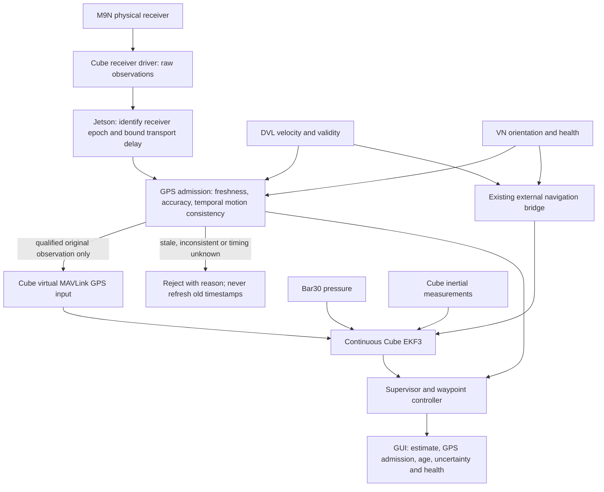

# Continuous EKF / Jetson GPS admission redesign — 2026-10-11

Status: design checkpoint, **not implemented or deployed**. The user authorized
development on `tether_toggle_beichen`, and instructed us to stop at unresolved
uncertainties rather than guess. Existing runtime behavior is unchanged.

## What changes conceptually

The previous Surface/Underwater profiles select different inputs to EKF3; they
are not two separate filters. The requested replacement is one continuous fusion
configuration, with Jetson deciding whether individual GPS observations qualify.
ArduSub retains responsibility for estimation and innovation rejection.

The physical GPS must NOT also be fused directly: otherwise rejected observations
can bypass Jetson. Candidate transport is physical receiver instance 0 and virtual
MAVLink receiver instance 1, with fixed primary selection and no fallback/blending.
GPS connector number is not proof of software receiver instance numbering.

Candidate fixed horizontal position source: qualified GPS. Candidate horizontal
velocity source: external DVL; yaw: validated external VN orientation; vertical
position: barometer. This is a candidate, not an approved parameter file. Verify
continued external-velocity aiding after GPS loss on the exact ArduSub build.
Do not reset EKF origin or bridge position when GPS is rejected/reacquired.

## Timing blocker discovered during inspection

The upstream ArduPilot source inspected on October 11 sends `GPS_RAW_INT.time_usec`
from `last_fix_time_ms(0) * 1000`. That is a Cube-side fix timestamp, not evidence
of the receiver's measurement epoch. The same source sends receiver instance 0
in GPS_RAW_INT, independently of which receiver is primary.

The upstream MAVLink GPS backend uses GPS_INPUT's GPS week and milliseconds of
week for jitter correction; copying a timestamp into `time_usec` alone does not
establish the desired measurement timing. These observations are from upstream
master, **not a verification of the vehicle firmware**. Attempts to retrieve the
previously recorded short firmware revision did not resolve through the web tool.

Primary sources inspected:
- https://github.com/ArduPilot/ardupilot/blob/master/libraries/AP_GPS/AP_GPS.cpp
- https://github.com/ArduPilot/ardupilot/blob/master/libraries/AP_GPS/AP_GPS_MAV.cpp

Do not label receive time as GPS time, derive GPS week from host wall clock without
a verified mapping, or infer measurement precision from a microsecond field name.
TIMESYNC can relate host and Cube clocks but cannot recover receiver measurement
latency that the telemetry never contained. SYSTEM_TIME alone likewise cannot
associate a particular receiver measurement epoch with a particular fix.

## Required evidence before replacing the runtime

1. Resolve and pin the actual Cube/SITL firmware source. Verify GPS_RAW_INT,
   GPS_INPUT, receiver-primary selection and loss-of-fix behavior in that version.
2. Establish a supported way to transport receiver measurement epoch together with
   the exact fix: a verified existing message, or explicit firmware/receiver
   transport work. Preserve receiver time, Cube time and Jetson monotonic arrival
   separately; measure clock offset uncertainty and end-to-end delay.
3. Demonstrate in isolated SITL that unqualified native GPS cannot bypass the gate
   and a missing Jetson does not cause fallback to raw GPS.
4. Demonstrate fixed-source DVL/VN aiding through GPS loss/recovery, with estimator
   logs showing actual fusion, position continuity and no command 42007 switching.
5. Only then migrate supervisor, waypoint readiness, GUI labels, launch files and
   tests together. Keep existing software operational until replacement is proven.

## Planned code migration

- New GPS admission module/node: explicit timestamp provenance, duplicate/replay
  rejection, bounded clock uncertainty, accuracy checks, time-aligned DVL/VN
  consistency, qualified/rejected events and reasons. Never synthesize zero
  velocity or replay an old accepted position during an outage.
- `navigation_supervisor.py` / `supervisor_logic.py`: stop commanding source-set
  transitions and requesting bridge realignment. Supervise depth, aiding health,
  mission reference and estimator continuity. Surface/submerged remain physical
  states, independent of whether GPS qualifies. No GPS recovery clears kill or
  controller inhibits, arms, or restores ESC permission.
- `nav_ekf_bridge.py`: preserve existing DVL/VN transport; validate frames and
  ensure integrated external position is not independently fused as absolute GPS.
- `waypoint_logic.py`: replace Surface/Underwater source-name prerequisites with
  explicit aiding/readiness requirements. Maintain pressure-depth checks, reference
  capture, pilot takeover and failure handling.
- GUI: raw GPS, Cube estimate and GPS admission remain distinguishable. Show
  measurement age and timing uncertainty, not a misleading “GPS fused” label
  merely because Jetson forwarded it. Actual fusion needs Cube evidence.
- Launch/parameters: one exclusive GPS-gate endpoint via MAVProxy; no second Cube
  serial owner. Commissioning remains disabled until firmware and SITL proof.

## Accuracy limits and follow-up decisions

DVL/VN consistency can reject implausible changes, but cannot prove that a GPS fix
has no constant geographic offset. Stationary single-antenna GPS does not measure
body heading. Do not add another heading correction based on GPS course at rest.
The October 10 operator yaw offset remains uncommissioned; no change made here.

Questions saved for the user's return:
- If current telemetry cannot preserve receiver measurement time, approve an
  explicit firmware/receiver transport change, or accept a measured Cube-fix-time
  approximation with a stated error bound? The latter is not precise GPS epoch
  synchronization.
- What maximum timing error and position error are required? Until defined and
  measured, no claim of “super accurate” synchronization is justified.

No vehicle access, parameter writes, source commands, arming or deployment were
performed during this investigation.

Validation: the existing 134-test regression suite passed under WSL/ROS Humble
on October 11 (5.464 seconds). This is a baseline check only; no new fusion code
or single-configuration SITL run was completed. Remote tether branch was fetched
and matched local HEAD before adding this document. An initial unprivileged Git
lookup failed DNS resolution; the approved network fetch succeeded.
