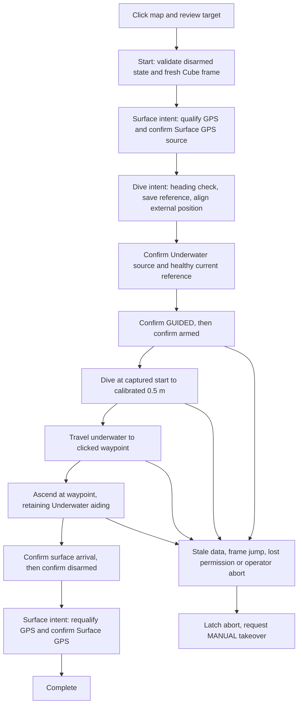

# Click-to-waypoint mission — October 10, 2026

Branch: `tether_toggle_beichen`. Local implementation and isolated SITL work;
no SSH, deployment, physical arming, main changes, or live parameter writes.

## Operator flow

Open the main GUI's **Waypoint mission** tab (`/waypoint`). The existing
Navigation page's Pool view (`/pool-map`) uses the same mission page with the
pool image selected. The page shows LIVE VEHICLE or SIMULATION explicitly.

1. Start disarmed at the surface, with calibrated depth, healthy navigation,
   validated heading/frame conventions, and commissioned EKF source profiles.
2. Select Cube geographic grid or Pool image. **Fit map / vehicle** includes
   the vehicle and selected target when fitting the pool image. The geographic
   grid has 2 m spacing and is centered on the Cube position when fitted.
3. Click a point. Review its latitude/longitude, distance, and dive depth
   (default 0.5 m; supported 0.3–1.0 m). The target must be 0.3–20 m away.
4. Click **Start mission** within 30 seconds. This authorizes GUIDED and arming
   after navigation preparation. Moving more than 0.5 m, changing coordinate
   frame, or rebooting since preview requires a fresh preview. Repeating the
   same accepted request cannot create another mission.
5. Watch the marked surface start, target, Cube heading/location/depth, mission
   stage, selected source and supervisor reason. Blue is the Cube estimate,
   green is the captured Cube surface start, pink is the target; gold raw GPS
   is separate. An unavailable/stale estimate is hidden, never replaced by GPS.
6. **Abort / take control** latches an abort and requests MANUAL. It does not
   automatically return home, continue the route, reset a fault, or restore
   ESC power. Verify MANUAL and take control. Existing physical kill and
   RF/tether failsafes remain separate.

Live execution is intentionally gated by `GRAEY_WAYPOINT_ENABLED=1` in the GUI
process environment **after commissioning**, as well as the live supervisor and
watchdog checks. This flag alone does not validate sensors or bypass them.
Live pool-image targets are blocked because the current image is not surveyed.
This release does not implement collision avoidance, a surveyed pool boundary,
or a validated pool geofence. Do not treat the target-range check as a boundary.

## Actual control sequence



The GUI only reviews a plan and starts one owned `waypoint_mission` process.
It does not publish motion setpoints. The runner uses its existing mission
MAVProxy endpoint `14553`, component 198, publishes navigation intent and
autonomy status, and sends Cube local-NED position/yaw targets. The supervisor
owns source selection and reference capture. The bridge remains core-owned;
the mission neither starts nor restarts it. MAVProxy remains the Cube's sole
serial-port owner. Existing prequal/demo missions are mutually excluded by the
GUI process checks; no automatic waypoint process is added to core launch.

The Cube remains the estimator and controller. The display uses its
`GLOBAL_POSITION_INT` and `ATTITUDE`, including underwater, with healthy
local-position/EKF checks. Raw GPS never drives the blue marker. A global
waypoint is converted using the Cube's reported EKF origin; the Cube's global
and local positions must agree within 0.75 m at preparation. The origin and
mission reference are frozen for the run; changes abort. No EKF origin reset
or image-based correction is sent to the Cube.

The supervisor's saved GPS/Cube reference remains the dive mission zero. The
runner additionally records the current Cube surface start after source
confirmation for its marker and descent hold point. Local down and calibrated
pressure depth can have different zeros: `surface_down = current_down - depth`.
Targets use that frozen offset plus requested pressure depth. Arrival requires
horizontal error ≤0.35 m, horizontal speed ≤0.15 m/s and depth within 0.08 m of
the dive target for one second. Surface arrival uses calibrated depth between
−0.10 and +0.12 m, with the same horizontal/speed dwell. These are commissioning
defaults, not demonstrated physical accuracy guarantees.

Navigation permission, source identity, reference identity, freshness and
position continuity remain checked while moving. A missed one-second mission
callback deadline aborts. Stale heartbeat is not treated as pilot takeover:
MANUAL requests continue until fresh telemetry confirms departure from GUIDED.
An actual pilot mode change/disarm is respected without repeated mode override.
Each stage has a finite timeout. There is no automatic restart after an abort.

## Accurate pool mapping

The existing screenshot uses the supplied reference 32.923570, −117.038550 at
original pixel (924,850), scale 3.048/150 m per pixel and assumed north-up.
That is an **approximate image registration**, not a surveyed reference. Fit or
zoom changes only presentation. It must not manufacture better coordinates.

Recommended next measurements:

* Survey at least three well-separated, recognizable pool-edge points, with
  measured coordinates and uncertainty; retain another point as an independent
  check. Use a surveyed/RTK reference or local surveying equipment, not the
  QGC home marker or a single instantaneous M9N fix.
* Fit image translation, rotation and scale from those controls, then measure
  the held-out residual. Record the uncertainty and measured water boundary.
  The current software does not yet accept/validate this survey automatically.
* Check the vehicle's absolute position independently at known pool points.
  A correctly registered image does not correct biased vehicle GPS. For tight
  pool navigation, a reproducible surveyed start fixture and independently
  measured heading can anchor a local trial; longer-term absolute accuracy may
  require a higher-accuracy positioning source.
* Validate a measured underwater out-and-back course and endpoint error before
  executing boundary-adjacent routes. Keep margins based on measured vehicle
  error plus mapping uncertainty, rather than the marker's apparent size.

DVL and IMU constrain motion and help reject inconsistent GPS jumps. They
cannot by themselves identify a constant absolute GPS/map offset. Averaging
stationary GPS can reduce noise but does not establish the absence of bias.
GPS course is only a motion-dependent heading check; it is not stationary yaw.
The M9N is a standard-precision receiver ([manufacturer product page](https://www.u-blox.com/en/product/neo-m9n-module)).

## Demonstrated bugs corrected

* ROS JSON parameter quoting initially prevented the runner from starting.
  Launch errors are now visible rather than silently leaving the GUI idle.
* The pre-dive heading check previously revoked permission when the vehicle
  crossed the depth threshold before the surface hysteresis dwell completed.
  Approval is retained only after a passed gate, saved current reference and
  confirmed Underwater source. New-run and SURFACE intent still clear it.
* WSL clock monitoring caught backward UTC steps (one measured −2.260 s) while
  an independent monotonic thread continued normally. Default ROS timer clocks
  delayed navigation callbacks and triggered legitimate freshness aborts.
  The bridge, supervisor, GUI and waypoint/SITL nodes now schedule timers on a
  steady clock. SITL synthetic sample ordering also uses steady time. The ROS
  node clock/UTC logging is not globally replaced. Freshness limits are intact.
  Physical VN/DVL timestamp conventions are unchanged; live clock-sync/restart
  behavior still needs validation and must fail closed if samples are rejected.
* Corrected the earlier VNYBA gyro-unit claim: the manufacturer defines rad/s.
  The supervisor converts to deg/s for its turn threshold. No VN mounting,
  pitch compensation or driver gyro units were changed.

## Reproduce locally

In WSL with the installed ROS Humble/ArduSub dependencies:

```bash
python3 -m unittest discover -s test
python3 sitl/validate_native.py --modes waypoint waypoint-abort drop-ack drop-source
# Interactive mode: same production runner, launched by the GUI button.
WAYPOINT_INTERACTIVE=true QGC_HOST= bash sitl/run.sh
```

Open `http://localhost:8090/waypoint` for the isolated simulation. The runner
reserves localhost endpoints, uses ROS domain 73 and disables QGC forwarding
by default. Do not mix this system-ID-1 simulation with live QGC traffic. The
simulator supplies synthetic DVL/VN/depth and tests integration behavior; it
does not validate pool hydrodynamics, real bottom lock or real GPS accuracy.

## Validation results

All 130 regression tests passed with ROS Humble loaded, no skips, using local
domain 74 and mocked hardware for the parameter tests. Native snapshot tests
without the ROS environment skipped those two tests; they were subsequently
run in the full suite. No real sensor/device was opened.

| Evidence under ignored `sitl/logs/` | Result |
| --- | --- |
| `graey-switch-9bmvjq5v` | Startup failed on ROS JSON parameter parsing; stopped and retained. Fixed quoting. |
| `graey-switch-0fs0ql47` | Dive aborted on the pre-dive gate during depth hysteresis. Fixed the completed-gate lifetime. |
| `graey-switch-im_dkome` | Aborted on freshness during arm preparation. |
| `graey-switch-nzf2he24` | Both runs reached underwater transit with GPS absent, then aborted on callback gaps during ascent. |
| `graey-switch-xaaypnys` | Freshness abort; independent monotonic monitor had no scheduling gaps. |
| `graey-switch-cao1a8_c` | Freshness abort; recorded a −2.260 s wall-clock step, identifying the timer cause. |
| `graey-switch-17z5kuhe` | Two complete waypoint missions passed after the steady-clock fix, including GPS outage, Cube location/heading underwater, disarm and GPS recovery. Wall-clock steps still occurred. |
| `graey-switch-949k4aot` | Complete waypoint, operator abort with MANUAL confirmed, missing ACK and missing source-report fault injections all passed. |
| `graey-switch-2cpbimyo` | Final GUI interlocks/latched abort revision passed underwater operator-abort simulation; GPS outage and Cube display were verified. |

Each native snapshot retains a manifest of source/binary hashes and the actual
logs/results, including failed attempts. The validation calls the same preview,
start and abort HTTP endpoints as the GUI and launches the production waypoint
runner. Duplicate start requests returned the same run ID. Browser inspection
also confirmed the mission/source and Cube fields rendered on the new page;
the automated test drives the HTTP flow rather than automating a canvas click.

The legacy Stop button now routes a running/starting waypoint to its latched
abort, avoiding a disarm/rearm startup race. Abort is resent until the mission
reports a terminal state. The final regression includes that path, commissioning
and pool-registration gates, stale/moved previews, changed origins/references,
pilot override, lost heartbeat, pressure/local-zero differences and clock choice.
Final mocked transport checks also cover the bounded disarmed startup wait for
the first watchdog report and Stop handling after a GUI restart.

### Still required on Graey

Deploy while disarmed, validate VN/Cube heading and DVL forward axes, confirm
calibrated surface depth and source reports from the real Cube, and inspect its
BIN log through source changes. Verify the physical kill/manual takeover and
that control inputs are neutral before enabling autonomous execution. Then run
a supervised short in-water trial with measured start/endpoint and bottom lock.
Pool registration and absolute position error remain unverified. Passing SITL
does not establish live GPS accuracy, stopping distance, drift or pool clearance.

## GUI diagnostics and armed waypoint preparation (2026-10-10)

Live supervisor API had fresh calibrated pressure depth around-0.03m while user
reported unavailable depth on its panel. Sensor failure not reproduced. Panel now
uses AbortController timeout rather than AbortSignal.timeout and displays network,
HTTP or missing-stream errors explicitly; pressure source identified separately
from mission readiness. Node VM test verifies rendering without timeout API and
error cases. This fixes a demonstrated compatibility failure, but original user
browser cause remains unverified until refresh/recheck.

Waypoint preview accepts already-armed MANUAL/STABILIZE. Mission waits for the
same navigation/source/reference checks, enters GUIDED and uses the already-armed
state without sending another ARM command. Pilot disarming during preparation
latches abort, preventing rearm. Other armed initial modes rejected. Completion
still surfaces/disarms. Live commissioning flag remains disabled.133 Python tests
passed; JS page test passed. No armed live mission test performed. Initial JS test
command used a wrong output path; corrected and reran successfully.

### Supervisor transport follow-up (2026-10-10)

User reported lost calibration/source display when submerging. Live inspection
found the same supervisor/bridge PIDs, valid pressure depth and Surface GPS source;
no actual source transition reproduced. GUI logs showed broken client connections
on navigation/waypoint full snapshot responses. Added a dedicated compact
/api/navigation/supervisor endpoint without up to1200 map-trail points. Supervisor
panel polls it at2Hz, retains explicit stale/connection handling and never treats
cached values as current. This reduces traffic; it does not repair underwater
Wi-Fi propagation or establish that the original issue is resolved in water.
Regression covers missing stream, freshness expiry, independent copies and depth.
